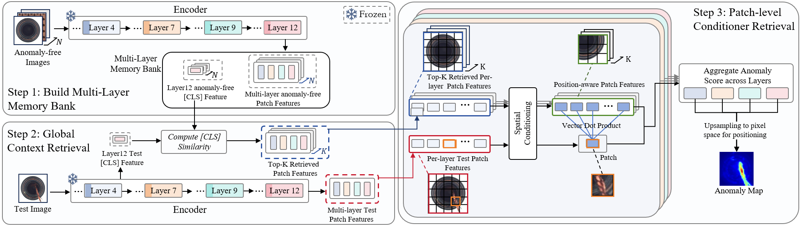

<h1 align="center">RAD</h1>
<p align="center"><strong>Is Task-Specific Training Necessary for Anomaly Detection?</strong><br>ICML 2026 · Official PyTorch implementation</p>

<p align="center"></p>

RAD performs multi-class image anomaly detection and localization with a frozen DINOv3 encoder and a multi-layer reference bank. It retrieves similar normal images, compares patch features, and combines scores across layers without task-specific parameter optimization.

**Training-free still requires normal training images:** first extract their features into a memory bank, then evaluate test images. The examples cover MVTec AD, VisA, Real-IAD, and the RGB modality of 3D-ADAM.

> **Memory-bounded implementation:** reference features and metric inputs are written to disk in batches. Retrieval uses bounded chunks while retaining every reference, every selected layer, and float32 features. See [memory management](docs/MEMORY_MANAGEMENT.md) and [validation](docs/VALIDATION.md) for the implementation and evidence.

## News

- **2026-05-01:** RAD accepted at ICML 2026.
- **2026-01-28:** Code released.

## Contents

- [Setup](#setup)
- [Datasets](#datasets)
- [Pretrained encoder](#pretrained-encoder)
- [Build a bank and evaluate](#build-a-bank-and-evaluate)
- [Parameters and reproducibility](#parameters-and-reproducibility)
- [Outputs](#outputs)
- [Memory requirements](#memory-requirements)
- [Interruption and recovery](#interruption-and-recovery)
- [Validation and compatibility](#validation-and-compatibility)
- [Acknowledgments](#acknowledgments)
- [License](#license)

## Setup

Run the commands from the repository root. Paths beginning with `../` refer to its parent directory. The CPU regression environment uses **Python 3.12**, **PyTorch 2.7.0**, and **torchvision 0.22.0**, with the dependency versions in [requirements.txt](requirements.txt). See [validation](docs/VALIDATION.md) for what was checked and the remaining full-dataset/CUDA checks.

```bash
git clone https://github.com/longkukuhi/RAD.git
cd RAD
conda create -n rad python=3.12 -y
conda activate rad
```

On an NVIDIA Linux/WSL host, install PyTorch from the official CUDA 12.8 index first, then install the remaining project requirements from the default package index:

```bash
python -m pip install torch==2.7.0 torchvision==0.22.0 --index-url https://download.pytorch.org/whl/cu128
python -m pip install -r requirements.txt
```

For CPU-only Linux, use the CPU PyTorch index in the first step:

```bash
python -m pip install torch==2.7.0 torchvision==0.22.0 --index-url https://download.pytorch.org/whl/cpu
python -m pip install -r requirements.txt
```

On macOS, install the requirements from the default index:

```bash
python -m pip install -r requirements.txt
```

These PyTorch/torchvision pairs and CUDA/CPU indexes follow the [official PyTorch 2.7.0 installation instructions](https://pytorch.org/get-started/previous-versions/#v270). Use a driver compatible with the selected CUDA build. The scripts select `cuda:0` when CUDA is available and otherwise use CPU; there is no `--device` option. The bank writer uses POSIX file locking, so use Linux/WSL or macOS rather than native Windows for these entry points.

The original experiments used an NVIDIA GeForce RTX 5090 (32 GB). A GPU's advertised capacity alone does not establish that a particular run fits: the entry points check the current RAM, VRAM, process and paging state before loading a model and continue monitoring during work.

| Stage | MVTec AD / VisA / 3D-ADAM | Real-IAD |
| --- | --- | --- |
| Extract normal reference features | `build_bank_multilayer.py` | `build_realiad_bank_multilayer.py` |
| Evaluate test images | `rad_mvtec_visa_3dadam.py` | `rad_real_iad.py` |

## Datasets

Keep the official training/test splits. Reference images must be normal. The MVTec-format builder rejects training folders containing any class other than `good`; the Real-IAD builder rejects any anomalous training label. They fail with an explanation instead of silently filtering samples. Do not use test images to build the bank.

### MVTec AD

Download [MVTec AD](https://www.mvtec.com/company/research/datasets/mvtec-ad) and extract it to `../mvtec_anomaly_detection`:

```text
mvtec_anomaly_detection/
└── bottle/                  # Repeat for each category.
    ├── train/good/
    ├── test/
    │   ├── good/
    │   └── <defect_type>/
    └── ground_truth/<defect_type>/
```

### VisA

Download [VisA](https://github.com/amazon-science/spot-diff) to `../VisA`, then convert it using the included 1-class split:

```bash
python prepare_data/prepare_visa.py \
    --split-type 1cls \
    --data-folder ../VisA \
    --save-folder ../VisA_pytorch \
    --split-file ./prepare_data/split_csv/1cls.csv
```

The resulting dataset root is **`../VisA_pytorch/1cls`**, with `<category>/train/good`, `<category>/test/{good,bad}`, and `<category>/ground_truth/bad` directories.

### Real-IAD

Obtain the dataset through the [Real-IAD project](https://realiad4ad.github.io/Real-IAD/). Extract both the images and JSON annotations so that these paths exist:

```text
Real-IAD/
├── realiad_1024/
│   ├── audiojack/
│   │   └── <image_path from JSON>
│   └── <other_category>/
└── realiad_jsons/
    └── realiad_jsons/
        ├── audiojack.json
        └── <other_category>.json
```

The loader reads `realiad_jsons/realiad_jsons/<category>.json` and resolves each image path under `realiad_1024/<category>/`. Both Real-IAD scripts default to the same 30 categories.

### 3D-ADAM

Download the [3D-ADAM anomalib-format dataset](https://huggingface.co/datasets/pmchard/3D-ADAM_anomalib) to `../3D-ADAM_anomalib`. These examples use **RGB images only**; `xyz` data are not used.

```bash
python prepare_data/prepare_3dadam.py \
    --data-folder ../3D-ADAM_anomalib \
    --save-folder ../3D-ADAM
```

The converted root is `../3D-ADAM`, with categories such as `1m1` and `1m2`. Each contains `train/good`, `test/<good_or_defect_type>`, and `ground_truth/<defect_type>`.

## Pretrained encoder

Download the **DINOv3 ViT-B/16 LVD-1689M** checkpoint from [Meta's DINOv3 downloads](https://ai.meta.com/resources/models-and-libraries/dinov3-downloads/) and place it at:

```text
../weights/dinov3_vitb16_pretrain_lvd1689m-73cec8be.pth
```

Alternatively, pass its local path with `--encoder_weight` in both the builder and evaluator. The loader expects a matching state dictionary and does **not** download weights automatically. Use the same encoder and checkpoint for both stages.

## Build a bank and evaluate

Each example first builds a shared bank from the listed normal training categories, then evaluates their test images. Check [memory requirements](#memory-requirements) before starting. The commands preserve the original dataset-specific settings:

| Dataset | `k_image` | `pos_radius` | Reference root |
| --- | ---: | ---: | --- |
| MVTec AD | 150 | 1 | `../mvtec_anomaly_detection` |
| VisA | 900 | 2 | `../VisA_pytorch/1cls` |
| Real-IAD | 900 | 0 | `../Real-IAD` |
| 3D-ADAM (RGB) | 48 | 1 | `../3D-ADAM` |

All four recipes enable the positional bank, use layers `3 6 9 11`, resize to 512, center-crop to 448, and evaluate at mask resolution 256. Dataset-specific `k_image` values are explicit recipe settings, not automatic defaults.

### MVTec AD

Build the reference bank:

```bash
python build_bank_multilayer.py \
    --data_path ../mvtec_anomaly_detection \
    --item_list carpet grid leather tile wood \
               bottle cable capsule hazelnut metal_nut \
               pill screw toothbrush transistor zipper \
    --encoder_name dinov3_vitb16 \
    --encoder_weight ../weights/dinov3_vitb16_pretrain_lvd1689m-73cec8be.pth \
    --image_size 512 \
    --crop_size 448 \
    --batch_size 32 \
    --num_workers 4 \
    --layer_idx_list 3 6 9 11 \
    --bank_path ./bank/mvtec_dinov3_vitb16_multilayer36911_448_bank
```

Evaluate:

```bash
python rad_mvtec_visa_3dadam.py \
    --data_path ../mvtec_anomaly_detection \
    --bank_path ./bank/mvtec_dinov3_vitb16_multilayer36911_448_bank \
    --encoder_name dinov3_vitb16 \
    --encoder_weight ../weights/dinov3_vitb16_pretrain_lvd1689m-73cec8be.pth \
    --save_dir ./saved_results_mvtec \
    --save_name mvtec_patch_knn_multilayer_36911_448 \
    --k_image 150 \
    --resize_mask 256 \
    --max_ratio 0.01 \
    --vis_max 8 \
    --use_positional_bank \
    --pos_radius 1 \
    --item_list carpet grid leather tile wood \
               bottle cable capsule hazelnut metal_nut \
               pill screw toothbrush transistor zipper
```

### VisA

Build the reference bank:

```bash
python build_bank_multilayer.py \
    --data_path ../VisA_pytorch/1cls \
    --item_list candle capsules cashew chewinggum fryum \
               macaroni1 macaroni2 pcb1 pcb2 pcb3 pcb4 pipe_fryum \
    --encoder_name dinov3_vitb16 \
    --encoder_weight ../weights/dinov3_vitb16_pretrain_lvd1689m-73cec8be.pth \
    --image_size 512 \
    --crop_size 448 \
    --batch_size 32 \
    --num_workers 4 \
    --layer_idx_list 3 6 9 11 \
    --bank_path ./bank/visa_dinov3_vitb16_multilayer36911_448_bank
```

Evaluate with the same VisA category list:

```bash
python rad_mvtec_visa_3dadam.py \
    --data_path ../VisA_pytorch/1cls \
    --bank_path ./bank/visa_dinov3_vitb16_multilayer36911_448_bank \
    --encoder_name dinov3_vitb16 \
    --encoder_weight ../weights/dinov3_vitb16_pretrain_lvd1689m-73cec8be.pth \
    --save_dir ./saved_results_patch_knn \
    --save_name visa_patch_knn_multilayer_36911_448 \
    --k_image 900 \
    --resize_mask 256 \
    --max_ratio 0.01 \
    --vis_max 8 \
    --use_positional_bank \
    --pos_radius 2 \
    --item_list candle capsules cashew chewinggum fryum macaroni1 \
                macaroni2 pcb1 pcb2 pcb3 pcb4 pipe_fryum
```

### Real-IAD

Build the reference bank using the default 30-category list:

```bash
python build_realiad_bank_multilayer.py \
  --data_path ../Real-IAD \
  --encoder_name dinov3_vitb16 \
  --encoder_weight ../weights/dinov3_vitb16_pretrain_lvd1689m-73cec8be.pth \
  --image_size 512 \
  --crop_size 448 \
  --layer_idx_list 3 6 9 11 \
  --bank_path ./bank/realiad_dinov3_vitb16_multilayer36911_448_bank
```

Evaluate:

```bash
python rad_real_iad.py \
  --data_path ../Real-IAD \
  --bank_path ./bank/realiad_dinov3_vitb16_multilayer36911_448_bank \
  --encoder_name dinov3_vitb16 \
  --encoder_weight ../weights/dinov3_vitb16_pretrain_lvd1689m-73cec8be.pth \
  --save_dir ./saved_results_realiad \
  --save_name realiad_multilayer_36911_448 \
  --k_image 900 \
  --resize_mask 256 \
  --max_ratio 0.01 \
  --vis_max 8 \
  --use_positional_bank \
  --pos_radius 0
```

### 3D-ADAM (RGB)

Build the reference bank:

```bash
python build_bank_multilayer.py \
    --data_path ../3D-ADAM \
    --item_list 1m1 1m2 1m3 2m1 2m2h 2m2m \
                3m1 3m2 3m2c 4m1 4m2 4m2c \
                gripper_closed gripper_open helicalgear1 helicalgear2 \
                rackgear spiralgear spurgear tapa2m1 tapa3m1 tapa4m1 tapatbb \
    --encoder_name dinov3_vitb16 \
    --encoder_weight ../weights/dinov3_vitb16_pretrain_lvd1689m-73cec8be.pth \
    --image_size 512 \
    --crop_size 448 \
    --batch_size 32 \
    --num_workers 4 \
    --layer_idx_list 3 6 9 11 \
    --bank_path ./bank/3dadam_dinov3_vitb16_multilayer36911_448_bank
```

Evaluate with the same 3D-ADAM category list:

```bash
python rad_mvtec_visa_3dadam.py \
    --data_path ../3D-ADAM \
    --bank_path ./bank/3dadam_dinov3_vitb16_multilayer36911_448_bank \
    --encoder_name dinov3_vitb16 \
    --encoder_weight ../weights/dinov3_vitb16_pretrain_lvd1689m-73cec8be.pth \
    --save_dir ./saved_results_patch_knn \
    --save_name 3dadam_patch_knn_multilayer_36911_448 \
    --k_image 48 \
    --resize_mask 256 \
    --max_ratio 0.01 \
    --vis_max 8 \
    --use_positional_bank \
    --pos_radius 1 \
    --item_list 1m1 1m2 1m3 2m1 2m2h 2m2m \
                3m1 3m2 3m2c 4m1 4m2 4m2c \
                gripper_closed gripper_open helicalgear1 helicalgear2 rackgear spiralgear \
                spurgear tapa2m1 tapa3m1 tapa4m1 tapatbb
```

## Parameters and reproducibility

| Option | Meaning / current behavior |
| --- | --- |
| `--data_path` | Dataset root in the layouts above. |
| `--item_list` | Categories to include. The shared MVTec/VisA/3D-ADAM scripts default to MVTec categories, so pass the correct list explicitly. |
| `--bank_path` | A version-2 **directory**, containing `manifest.json`, per-layer float32 data and reference sidecars. Use a new path for a new bank. |
| `--layer_idx_list` | Builder only; zero-based encoder block indices, saved in sorted order. Default: `3 6 9 11`. |
| `--image_size`, `--crop_size` | Builder only; defaults 512 and 448. Evaluators use those fixed values and reject a bank with different preprocessing. |
| `--batch_size`, `--num_workers` | Available in both stages. Builder defaults: 32 and 4. Evaluator defaults: 8 and 4. Worker prefetch is bounded to one batch per worker. |
| `--k_image` | Retrieved reference images per test image. Evaluation CLI default: 150. Must be positive and no larger than the bank's image count. |
| `--resize_mask` | Anomaly-map and ground-truth mask resolution. Default: 256. |
| `--max_ratio` | Fraction of highest-scoring pixels averaged for the image score. Default: 0.01; 0 selects the maximum. A nonzero value must select at least one pixel. |
| `--use_positional_bank` | Enables comparisons within a spatial patch neighborhood; disabled unless supplied. |
| `--pos_radius` | Neighborhood radius in patch units; 0 uses the same patch position only. Default: 1. |
| `--layer_weights` | Optional finite weights in the saved bank's layer order. Omitted weights are uniform; provide one per layer to override. |
| `--vis_max` | Maximum saved test visualizations per category. Default: 8; 0 disables image saving. |
| `--save_dir`, `--save_name` | Outputs are placed under `<save_dir>/<save_name>/`. Use a distinct name for each new scientific configuration. |
| `--reference-chunk-size`, `--query-patch-chunk-size`, `--cls-chunk-size` | Evaluation read/compute chunk limits; defaults 8 reference images, 32 query patches and 4096 CLS rows. They do not change `k_image` or discard bank references. |
| `--memory-workspace-mib`, `--max-score-mib` | Evaluation workspace and scalar image-score limits; defaults 256 MiB and 128 MiB. These are buffer limits, not the whole task's memory budget. |
| `--metric-chunk-size` | Maximum records per external-sort metric chunk. Default: 262144. |
| `--ram-budget-gib`, `--gpu-budget-gib` | Optional total peak-memory budgets that override the printed analytic estimates. Supply measured, conservative budgets; these flags do not allocate memory or waive the resource checks. |
| `--resume-bank`, `--resume-eval` | Explicit recovery in the respective builder/evaluator after validating the saved inputs and protocol. |
| `--cleanup-metric-spool` | Remove temporary metric files only after successful metrics publication. By default they remain available for inspection and recovery. |

The bank records the encoder/checkpoint SHA-256, preprocessing, category order, reference paths and fingerprints, float32 dtype, seed, and source revision. Evaluators validate the checkpoint and preprocessing before inference. Recovery additionally checks the saved input/protocol signatures; changed data or scientific settings require a new output path.

Reference indices map to the bank's saved paths. Training images are needed for retrieved-neighbor visualizations and are checked against their fingerprints. With `--vis_max 0`, evaluation does not rebuild a training `ImageFolder` or require reference images just to load the saved features. Test data and the checkpoint remain required for provenance checks, including recovery.

All four entry points use **seed 1** and expose no `--seed` option. The recipes schedule no additional seeds. Feature extraction and retrieval retain float32 precision, all normal references, all selected layers, the 512-to-448 preprocessing, and the original dataset-specific settings. Resource tuning must not silently change these scientific choices. CPU synthetic equivalence checks do not establish bitwise equality across different GPU kernels or hardware; see [validation](docs/VALIDATION.md).

## Outputs

A completed bank directory contains `manifest.json`, `layer_<index>_cls.f32`, `layer_<index>_patches.f32`, `references.jsonl`, and `references.idx`. The manifest is published only after all reference rows are committed; `.progress.json` supports an interrupted build.

Evaluation writes under `<save_dir>/<save_name>/`:

- **`log.txt`**: per-category and mean I-AUROC, I-AP, I-F1, P-AUROC, P-AP, P-F1, and P-AUPRO. I-F1 and P-F1 are the maximum F1 values over thresholds, not fixed deployment-threshold scores.
- **`metrics/<category>/metrics.json`**: the seven category metrics and retrieval buffer observations; **`summary.json`** contains category results and their mean.
- **`metrics/<category>/evaluation-inputs.json`**: the checkpoint, bank and dataset/protocol signature; **`metrics/<category>/spool/`** holds committed maps, labels and scores plus temporary metric files.
- **`resources.jsonl`** and **`<category>-execution.json`**: admission/monitoring records and the execution configuration. Resource records distinguish estimates from observed process-memory samples.
- **`test_vis_multilayer_cluster/<category>/`**: up to `vis_max` visualizations per category.

Logs append, while existing evaluation state requires explicit `--resume-eval` and matching inputs. Keep each new configuration in its own run directory. A successful matching category can be reused on resume; incomplete state is retained for recovery.

## Memory requirements

The complete feature bank occupies disk space instead of remaining in host RAM or VRAM. Builders write each batch immediately and retain no growing feature list. Readers use bounded explicit disk reads, and retrieval compares every selected neighbor in chunks. Evaluation spools maps to disk, computes ranking metrics through an external sort, and processes AUPRO one image at a time.

For the example ViT-B/16 configuration, four layers of 28 × 28 patches with 768 float32 features require:

```text
patch bank disk bytes = N × 4 × 28 × 28 × 768 × 4
                      = N × 9,633,792 bytes
```

CLS features and metadata add further storage. This is an analytic storage formula, not a measured peak-memory result. Reserve disk space for the bank, metric inputs and external-sort temporary files; their sizes still grow with the complete dataset.

Resource guards check physical/available RAM, current processes and active paging, plus dedicated GPU memory when using CUDA. On WSL they also require verifiable Windows-host and effective Linux memory limits and shared-GPU-memory evidence. The default RAM reserve is at least **8 GiB and 20% of effective physical RAM**; small hosts require an explicitly appropriate reserve configuration. Checks run before model loading and periodically during extraction, retrieval and metrics. Unverifiable resources, insufficient capacity or sustained paging stop the task with a record; the guard never kills unrelated jobs or changes system swap/pagefile settings.

The default task budgets are conservative estimates derived from the encoder, batch size, input dimensions, workers and configured buffers. Adjust bounded batch/chunk sizes or provide a validated measured budget when the initial estimate does not fit. Do not reduce reference counts, precision, resolution or scientific settings merely to satisfy a memory limit. See [memory management](docs/MEMORY_MANAGEMENT.md) for budget semantics, storage accounting and tuning.

## Interruption and recovery

After resolving the recorded cause, rerun the **same builder command** with `--resume-bank` to continue an incomplete bank. The writer verifies the committed prefix and identical input provenance before continuing at the next reference row. A completed bank is reused directly by evaluation; it is not resumed or overwritten by the builder.

Rerun the **same evaluation command** with `--resume-eval` to keep completed categories and continue from committed prediction batches. When every requested category already has all predictions, recovery computes or reuses metrics on CPU without loading the encoder or allocating GPU memory. Scientific configuration or dataset-signature changes require a new `--save_name`. Recovery is explicit: a resource stop never schedules another seed or automatically restarts an experiment.

Legacy `.pt`/`.pth` banks are not loaded automatically. Rebuilding a version-2 bank is the preferred route. For a trusted legacy bank that fits an explicitly checked resident-memory budget, `python rad_bank.py migrate --help` describes the opt-in migration command. It requires verified provenance and reference records in the original row order; missing metadata must not be guessed from the filename. Large legacy banks that cannot fit the migration budget must be rebuilt with the streaming builder.

## Validation and compatibility

The active metric implementation no longer depends on pandas `DataFrame._append`; the previous pandas/AUPRO mismatch has been removed. Dependency pins now target the Python 3.12 CPU regression environment described above. The bank, bounded retrieval, metric and recovery checks use small synthetic data and do not download a model or start a benchmark.

See [validation evidence and limitations](docs/VALIDATION.md) for the exact checked revision, commands and results. A full DINOv3 dataset run, target-host CUDA behavior and measured experiment memory require their own resource-admitted validation; the synthetic checks are not reported as reproduction of the paper's benchmark scores.

## Acknowledgments

This repository builds on [Dinomaly](https://github.com/guojiajeremy/Dinomaly), [DINOv3](https://github.com/facebookresearch/dinov3), and other contributions from the community. Please also follow the upstream projects' and datasets' terms.

## License

Original RAD material is provided under the [RAD Strict Noncommercial License 1.0](LICENSE). **Commercial use is prohibited** without separate express prior written authorization from the relevant rights holders. This includes commercial products, internal business use, commercial evaluation, paid services, and research directed toward commercialization or technology transfer. **Universities and research institutes have no exemption for commercial collaborations**; publication or nonprofit status does not make such work permissible. Independent noncommercial research, teaching and reproducibility work are permitted within the license's conditions.

This is a source-available noncommercial license, not an OSI-approved open-source license. It applies only to material the RAD copyright holders have authority to license. Third-party code, datasets and pretrained weights retain their own terms; see [THIRD_PARTY_NOTICES.md](THIRD_PARTY_NOTICES.md), the preserved source headers and the official license copies in [licenses/](licenses/). The notice inventory also identifies origins and rights that still require confirmation; it does not claim completed legal clearance.
